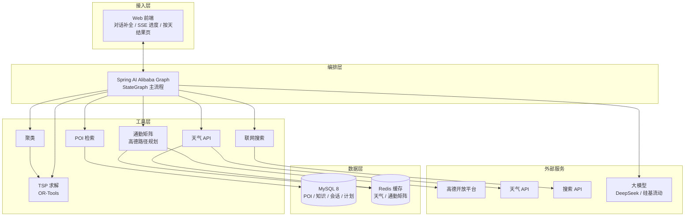
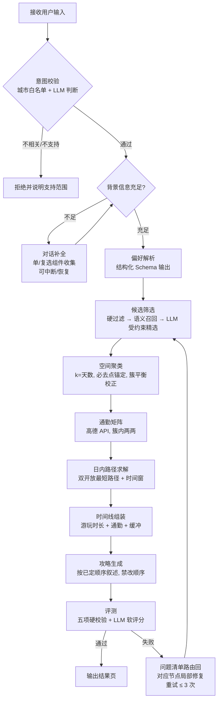

# tripmap MVP 设计说明书

| 项目 | 内容 |
| --- | --- |
| 版本 | v1.0 |
| 日期 | 2026-11-03 |
| 状态 | 已通过（v1.0：决策收敛——缓存 Redis、无知识库、试点杭州、前端 Vue 3、LLM 候选 DeepSeek/硅基流动） |

---

## 1. 概述

### 1.1 项目背景

用户自助规划旅游行程时，需要在多款 App 之间反复收集信息（景点、天气、交通、攻略），耗时且质量参差。本系统以 Agent 编排为核心，根据用户的背景描述自动生成结构化的多日旅游行程与攻略，将"规划"这一步骤自动化。

### 1.2 MVP 目标

- MVP 阶段仅支持 **杭州** 一个城市，端到端跑通“背景输入 → 自动规划 → 评测校验 → 攻略输出”全流程；西安、重庆于 MVP 评测阶段随评测一并引入；
- 每日行程满足"一天一个区域"，几何正确性由算法与外部 API 保证，不由模型保证；
- 规划结果通过确定性硬校验与 LLM 软评分双重评测，不达标自动局部修复。

### 1.3 成功标准

- 试点城市输入一份完整背景后，系统在 3 分钟内产出通过全部硬校验的行程与攻略；
- 每日路线通勤占比 ≤ 30%，任意相邻景点通勤时间 ≤ 40 分钟（阈值可调）；
- 行程中所有实体（景点、商圈）均来自 POI 库，存在性校验通过率 100%。

### 1.4 名词约定

| 名词 | 含义 |
| --- | --- |
| POI | 兴趣点，本系统指结构化的景点/商圈/交通枢纽数据记录 |
| TSP | 旅行商问题：求经过若干点各一次且总通勤时间最短的访问顺序 |
| 双开放最短路径 | 起点与终点均由求解器自由选择的最短访问路径（最短 Hamiltonian 路径），每日独立求解 |
| 图编排 | 以状态图（StateGraph）方式组织 Agent 流程：节点为计算步骤，边控制流转 |
| 硬校验 | 由代码执行的确定性检查（预算、日期、通勤等），不依赖模型 |
| 目的地预算 | 用户在目的地期间的吃、行、玩花费总额，**不含**往返大交通与酒店 |

---

## 2. 产品范围

### 2.1 MVP 做什么

- 城市概览介绍（风光、历史、美食等，来自联网搜索，结果强制引用来源）；
- 行程期间逐日天气（天气 API 实时查询，远期行程降级为气候参考）；
- **每日行程规划（核心）**：候选筛选 → 空间聚类分区 → 日内双开放路径排序 → 时间线组装；
- 旅游注意事项与建议（全部来自带引用约束的联网搜索，无来源事实句删除）；
- 多轮对话式背景补全与评测失败的自动修复。

### 2.2 MVP 不做什么（及替代处理）

| 不做 | 原因 | 替代处理 |
| --- | --- | --- |
| 酒店推荐 | 真实性/时效性要求高，个人无力采集 | 不锚定酒店；每日路径起终点由求解器自由选择，并把终点设计为"酒店友好型"（落在商圈/枢纽附近），用户拿到规划后自行按终点订酒店 |
| 大交通（往返城际）查询 | 同上 | 预算口径定义为"目的地预算"；每日路径不设固定起点，抵达方式仅在攻略叙述中提及 |
| 知识库存储 / 完整 RAG（向量库） | 内容时效性要求高，人工维护知识条目成本大；MVP 不做任何本地知识内容存储 | 城市介绍、攻略素材、注意事项全部走联网搜索，强制引用来源，无来源事实句删除 |
| MCP 协议接入 | 工具均为自研，MCP 只增加协议与部署成本 | 直接使用框架函数调用；工具增多后再评估迁移 |
| 地图路线渲染 | 后期需求 | 结果页先做按天文本卡片 + 景点列表 |
| 参考其他用户历史方案 | 协同过滤属后期能力 | 不做 |

---

## 3. 试点城市

**MVP 阶段仅启用杭州**；西安、重庆在 MVP 评测阶段引入，分别用于验证“跨簇日”（临潼兵马俑）与“立体交通”（山城直线距离失真）两类场景的鲁棒性。备选苏州暂缓。

| 城市 | 定位 | 选择理由 |
| --- | --- | --- |
| 杭州 | 首选（低难度） | 景点簇边界极清晰（西湖环线、灵隐—龙井、西溪、良渚、钱江新城），最适合展示与验证"一天一区域"；POI 数据量大、地铁覆盖好 |
| 西安 | 中难度 | 文化主题分区强，攻略生成内容感好；临潼兵马俑距市区约 1 小时，是天然的"跨簇日"测试用例 |
| 重庆 | 高难度（压力测试） | 山城立体交通使直线距离严重失真，最能检验"通勤矩阵取代直线距离"的设计；适合作为第三城验证鲁棒性 |

备选：苏州（可作杭州替代）。不建议首城选北京——预约制景点（故宫、陕历博等）会显著增加时间窗校验复杂度。

---

## 4. 系统架构

分层职责：

- **接入层**：多轮对话、结构化组件补全、SSE 流式输出与节点级进度展示；
- **编排层**：状态图定义主流程，节点为计算步骤，条件边路由，支持中断（补全对话）与恢复、局部回退循环；
- **工具层**：六个工具，模型只能看到这些工具的签名，事实全部来自工具；
- **数据层**：MySQL 存 POI、会话与计划（MVP 使用，后续平滑迁移 PostgreSQL）；Redis 缓存天气与通勤矩阵（兼作高德 QPS 限流保护）；
- **外部服务**：高德（POI 采集与路径规划）、天气 API、搜索 API、大模型。

---

## 5. 核心流程

### 节点职责表

| 节点 | 执行者 | 职责 |
| --- | --- | --- |
| 意图校验 | 代码 + LLM | 白名单城市过滤；LLM 一次判断相关性，输出结构化 verdict |
| 背景收集 | 编排层（中断/恢复） | 自由文本首轮解析，缺失字段用组件追问；产出完整背景 Schema |
| 偏好解析 | LLM | 输出结构化 Schema（人员构成、日期、目的地、预算、偏好） |
| 候选筛选 | 代码 + LLM | SQL 硬过滤 → 向量/标签召回 20～40 个 → LLM 受约束精选 top-N（N≈天数×5），ID 回库校验 |
| 聚类 | 算法 | K-Means（k=天数），必去点锚定，簇大小平衡，簇直径/商圈校正 |
| 通勤矩阵 | 高德 API | 簇内两两通勤时间，批量并行调用，结果写缓存 |
| TSP 求解 | OR-Tools | 双开放路径（起终点自由选择），开放时间时间窗，终点酒店友好偏好 |
| 时间线组装 | 代码 | 游玩时长 ×1.2 buffer + 段间通勤 + 午餐时段 → 当日时间表 |
| 攻略生成 | LLM | 按已定顺序输出叙述与城市/注意事项内容；不得增删或调换景点 |
| 评测 | 代码 + LLM | 五项硬校验 + LLM 软评分；失败输出结构化问题清单并路由回对应节点 |

---

## 6. 关键算法设计

### 6.1 候选筛选

1. **硬过滤（SQL）**：城市匹配、正常开放、门票 ≤ 预算约束、建议游玩时长 ≤ 每日可用时间；
2. **语义召回**：按偏好标签/简介相似度召回 20～40 个；
3. **受约束精选（LLM）**：要求模型仅从候选清单中选择，结构化输出 ID 列表；所有 ID 回库校验存在性，清单外 ID 直接拒绝；
4. **可行性预检**：用户指定必去组合先做时间窗预检（如"周一 × 博物馆闭馆"），无解尽早回到对话环节告知用户。

### 6.2 空间聚类

- 输入：精选后的 top-N 个 POI 经纬度；参数 k = 行程天数；
- 方法：K-Means（haversine 球面距离），`sklearn` 或自实现；
- 锚定：用户必去景点先各占一天（或按用户意愿集中），再分配剩余点；
- 平衡：簇间大小差 > 2 时，将大簇离质心最远的点移交小簇；
- 校正：用 POI 的行政区/商圈字段修正"跨江跨山被误聚"的点（交由通勤矩阵校验暴露）。

### 6.3 日内路径规划（双开放最短路径，本版核心设计决策）

**决策：每日独立求解、不设固定起点、不做天间链接。** 用户使用顺序是"先规划、后订酒店"，且每天的真实动线是"酒店 → 当日景点 → 酒店"，其中酒店位置在规划阶段是未知变量。因此：

- **不做天间链接**。若强制"当日起点 = 前一日终点"，等于让当天的路径求解去迁就一段现实中不存在的路程（用户并不会从前一日终点直接走到当日首站，中间隔了一晚住宿），既增加耦合，又降低单日路径质量；
- 每日问题建模为**双开放最短路径**：给定簇内 4～6 个 POI，起点与终点均由求解器自由选择，输出总通勤时间最短的访问顺序——即纯粹的"给几个景点选一条最优路线"；
- **求解实现**（4～6 个点规模下两种都 trivial）：
  1. **零成本虚拟节点法**：构造一个到所有 POI 通勤成本为 0 的虚拟节点作为车辆起点与终点，退化为标准 TSP 求解；
  2. **起终点枚举法**：枚举全部有序 (起点, 终点) 组合（6 点约 30 组），每组作为固定两端的路径 TSP 求解，取总时间最小者——精确且便于加入偏好项；
- **酒店友好终点（软偏好）**：在枚举法中对"终点距商圈/地铁枢纽 ≤ 阈值（如 800m）"的顺序施加少量罚分或优先选取；无满足者则放弃该偏好，不阻塞流程；
- **日序安排**：簇到天的分配按簇质心邻近关系排序（相邻天的区域尽量接近），仅为降低用户换区成本，不构成对日内路径的约束；
- 各天求解相互独立，可并行执行，单日失败不影响其他日期。

### 6.4 时间窗与缓冲

- 开放时间来自 POI 表**结构化字段**（见 8.1），按行程日期推算星期几后做硬约束；
- 夜景类景点强制安排在日落时段之后；
- 每景点游玩时长 × 1.2 作为缓冲；每簇额外准备 1～2 个替补景点，应对闭馆/约满/天气。

---

## 7. 评测与回退

### 7.1 硬校验（代码执行，零 Token 成本）

| # | 校验项 | 规则 |
| --- | --- | --- |
| 1 | 预算加总 | 门票 + 餐饮估算 + 市内交通估算 ≤ 目的地预算 |
| 2 | 日期覆盖 | 行程天数与起止日期完全一致，无重复无遗漏 |
| 3 | 开放时间冲突 | 景点开放时段与计划到访时段匹配（含闭馆日） |
| 4 | 通勤指标 | 当日任意相邻两点 ≤ 40 分钟；当日通勤占比 ≤ 30% |
| 5 | 实体存在性 | 行程中所有 POI ID 均在库且状态正常 |

### 7.2 软评分（LLM-as-Judge）

- 评分维度：偏好匹配度、节奏合理性、攻略可读性；
- 输出：分数 + 结构化问题清单。

### 7.3 回退路由

- 预算问题 → 候选筛选/时间线节点；通勤问题 → 聚类节点；开放时间问题 → 候选筛选节点（启用替补）；
- 单点失败局部修复，**禁止整轮重跑**；
- 全局重试上限 3 次，达到上限输出当前最优结果 + 未解决问题提示。

---

## 8. 数据设计

### 8.1 POI 表（`poi`）

| 字段 | 类型 | 说明 |
| --- | --- | --- |
| id | bigint | 主键 |
| name | varchar | 名称 |
| city / district / biz_area | varchar | 城市 / 行政区 / 商圈 |
| longitude / latitude | decimal(10,6) | 经纬度（**不用** MySQL 空间类型，空间计算在代码层） |
| category | varchar | 分类（人文/自然/美食/商圈/枢纽…） |
| tags | json | 标签（亲子、夜景、小众…） |
| rating | decimal | 评分 |
| ticket_price | decimal | 门票价格（0 = 免费） |
| suggest_duration | int | 建议游玩时长（分钟） |
| **open_hours** | **json** | **结构化开放时段：按周一～周日存 {open, close}，closed=true 表示闭馆** |
| brief | text | 简介 |
| source | varchar | 数据来源（高德/人工） |
| status | tinyint | 正常/闭园/下架 |

> 关键约束：`open_hours` 必须是结构化数据，时间窗校验依赖它；自由文本开放时间不可接受。

### 8.2 会话与计划表（`session` / `itinerary`）

- `session`：会话状态、图执行 checkpoint（中断/恢复用）、背景 Schema；
- `itinerary`：计划摘要（每日 JSON：顺序、时间线、预算明细）、评测结果、版本号。

### 8.3 缓存策略（Redis）

| 数据 | Key | TTL |
| --- | --- | --- |
| 天气 | city + date | 30～60 分钟 |
| 通勤矩阵 | poi_id_a + poi_id_b + 出行方式 | 7 天 |

通勤矩阵缓存同时是**高德 QPS 限流保护**：同批 POI 对的重复规划不再触发 API 调用。

---

## 9. 工具层规格

| 工具 | 类型 | 输入 | 输出 |
| --- | --- | --- | --- |
| POI 检索 | 本地算法 | 城市、过滤条件、偏好 | 候选 POI 列表 |
| 天气查询 | 外部 API | 城市、日期 | 逐日天气/温度/降水 |
| 通勤矩阵 | 外部 API（高德） | POI ID 列表、出行方式 | 两两通勤时间矩阵 |
| 空间聚类 | 本地算法 | POI 列表、k | 簇分配结果 |
| TSP 求解 | 本地算法（OR-Tools Java） | 矩阵、时间窗 | 访问顺序（含起终点） |
| 联网搜索 | 外部 API | 查询词 | 带来源的检索结果 |

攻略写作为 LLM 节点，不是工具。

---

## 10. 技术选型

| 项 | 选型 | 说明 |
| --- | --- | --- |
| 语言 / 运行时 | Java 17 |  |
| 编排框架 | Spring AI Alibaba Graph | StateGraph/节点/条件边/中断恢复；Java 栈首选 |
| 求解器 | Google OR-Tools（Java 版） | 双开放最短路径 + 时间窗 |
| 数据库 | MySQL 8（MVP） | 后续平滑迁移 PostgreSQL；DDL 保持方言中立、不绑定迁移工具，迁移时空间计算仍在代码层 |
| 缓存 | Redis | 缓存天气与通勤矩阵；兼作高德 QPS 限流保护；本地开发可用容器 |
| 前端 | Vue 3 | 对话补全 / SSE 进度 / 按天结果页三件套 |
| 实时推送 | SSE | 节点级进度 + 攻略流式输出 |
| 大模型 | DeepSeek（flash 档位）/ 硅基流动 | 二选一或双接；统一 ChatClient 抽象，供应商可替换 |
| 外部服务 | 高德开放平台、天气 API、搜索 API | 天气候选和风，搜索候选博查；均为非阻塞选型，任务推进至对应工具时再定；注意高德配额与授权条款，采集遵守 QPS 限制 |

---

## 11. 前端形态

1. **对话式信息收集**：首轮自由文本输入；系统解析后缺失字段以单/复选组件追问；展示规划过程节点进度（"正在查天气""正在规划第 2 天…"）；
2. **结果页**：按天卡片（时间线 + 景点列表 + 当日天气 + 终点商圈提示"建议住宿区域"）+ 城市介绍 + 注意事项；
3. 明确不做地图渲染（后期）。

SSE 事件约定：`node_progress`（节点级进度）、`token_stream`（攻略流式）、`validation_issue`（校验回退提示）、`done`。

---

## 12. 背景信息 Schema

两段式收集：自由文本 → 组件补全。字段定义：

| 字段 | 必填 | 组件 | 说明 |
| --- | --- | --- | --- |
| 人员构成 | 是 | 数字步进 + 标签 | 成人/儿童/老人数量，影响节奏与景点类型 |
| 出行日期 | **是** | 日期区间选择 | 天气按日映射与闭馆日校验的前提 |
| 目的地 | 是 | 城市选择（白名单） | 具体到市 |
| 目的地预算 | 是 | 数字输入 | 不含大交通与酒店，文案明示 |
| 旅游偏好 | 是 | 多选 + 自由补充 | 历史文化/自然/美食/亲子/购物/小众/轻松/紧凑 |
| 必去景点 | 否 | 文本/搜索 | 作为聚类锚点 |

---

## 13. 里程碑

| 里程碑 | 内容 | 预估 |
| --- | --- | --- |
| M1 数据底座 | 高德接入；杭州 POI 采集 300～500 条并清洗入库 | 1～2 周 |
| M2 工具层 | 六个工具实现 + 单测（含 OR-Tools 链路验证） | 2～3 周 |
| M3 编排闭环 | StateGraph 主流程；对话补全与中断恢复；评测与局部回退 | 2～3 周 |
| M4 前端与打磨 | 三件套页面、SSE、联调、demo 数据打磨 | 1～2 周 |
| M5 评测与城市扩展（MVP 完成后） | 西安、重庆 POI 采集与联调；跨簇日（临潼）与立体交通（重庆）鲁棒性评测；PGSQL 迁移方案选型 | 视排期 |

---

## 14. 风险与开放问题

| 风险 | 应对 |
| --- | --- |
| 联网搜索幻觉（注意事项类错误成本高） | 内容全部以联网搜索为准并强制引用来源，无来源事实句删除；敏感事项（预约、禁忌等）在攻略中引导用户出行前二次核实 |
| 远期天气不可用 | >15 天的行程降级为历史气候参考并在文案中说明 |
| 高德配额/授权限制 | 通勤矩阵全量缓存；POI 采集遵守 QPS 与服务条款 |
| 预约制景点（陕历博等） | MVP 不做预约状态接入；攻略生成时通过联网搜索在文案中提示“需提前预约” |
| LLM 输出漂移 | 全链路结构化输出 + ID 回库校验；攻略节点禁改顺序 |
| 天气影响当日安排 | 簇内室内景点加权重排（语义层微调，调整后重跑硬校验） |

## 15. 待确认决策

1. ~~试点城市最终名单~~（已定：MVP 仅杭州；西安、重庆于评测阶段引入）；
2. ~~大模型供应商~~（已定：DeepSeek（flash 档位）与硅基流动两个候选，二选一或双接，以统一抽象屏蔽差异）；
3. 天气与搜索 API 供应商（候选：和风、博查；非阻塞项，任务推进至对应工具（天气工具 / 搜索工具）时再最终确定，不影响其他任务）；
4. ~~前端框架~~（已定：Vue 3）。